# Mirror Ward

A short, dithered, monochrome pilgrimage that runs in the browser. You read an inscription and climb down into the earth. You cross a bridge over a black gorge and wake beside an abyss with a sword in your hand. Then you walk on through snowfields, a burning hut, a canyon of ravens, a ruined clifftop city, a timber village and a lake round a standing stone, and at last reach a tower in a field of red roses.

The only colour is red.

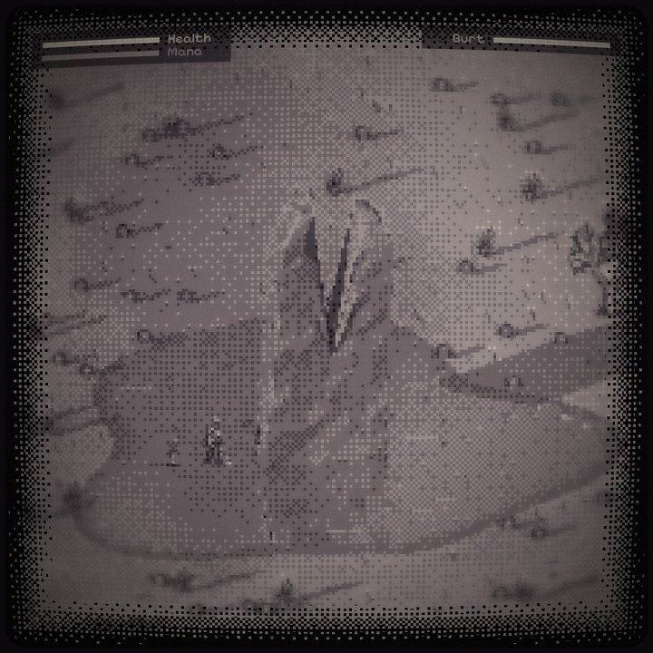

## Play

Play it at **<https://mpts.ie/games/mirrorward/>**, or open `index.html` in a modern browser. It loads three.js from cdnjs and two fonts from Google Fonts, so it needs an internet connection. Everything else, including all the art, is inside the one HTML file.

To serve it locally:

```bash
python3 -m http.server 8000
```

Then open <http://localhost:8000>.

| Key | Action |
| --- | --- |
| W A S D, arrows, or click | Move |
| Shift | Run |
| E | Act: read, take, speak, dig, open |
| Space | Swing the sword |
| F or right-click | Cast fire toward the cursor (needs the Ring of Fire; uses mana) |
| I | Inventory |
| H | Hand (rings) |
| Esc | Close the inventory or hand |

The area list under the game jumps straight to any part of the journey, with the items and companion you would have by then. **New game** starts again from the stone.

## The journey

| | |
| --- | --- |
| 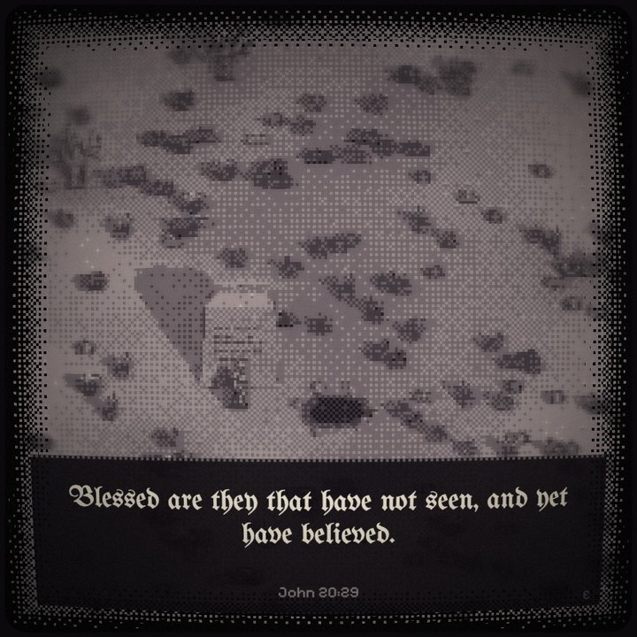 | 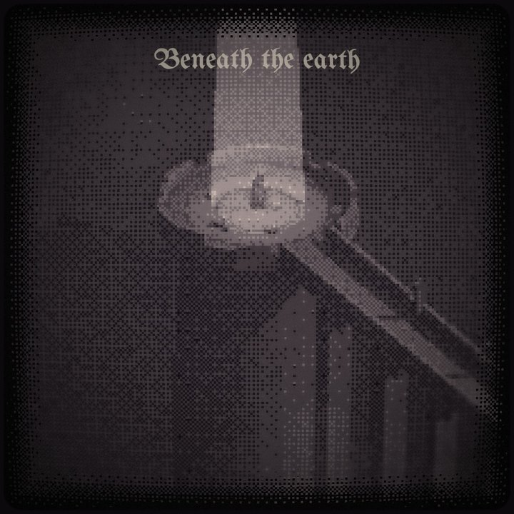 |
| **The beginning.** A stone, and a hole in the earth beside it. | **Beneath the earth.** You fall into a round courtyard at the head of a bridge. |
| 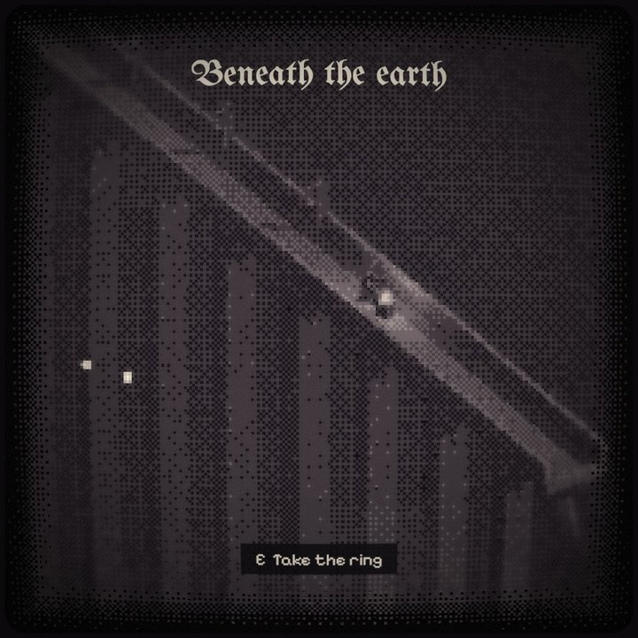 | 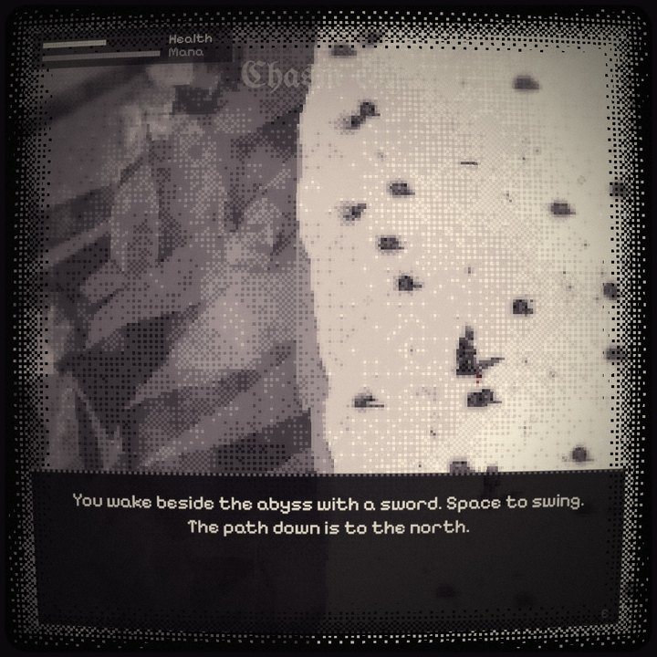 |
| **The bridge.** The first ring waits at the far end. | **Chasm edge.** You wake with a sword, bleeding a little. |
| 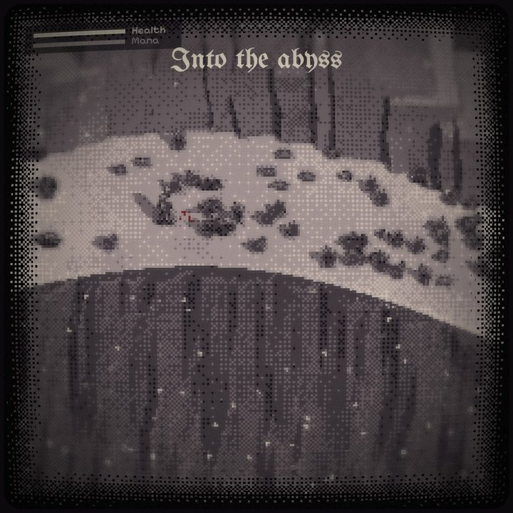 | 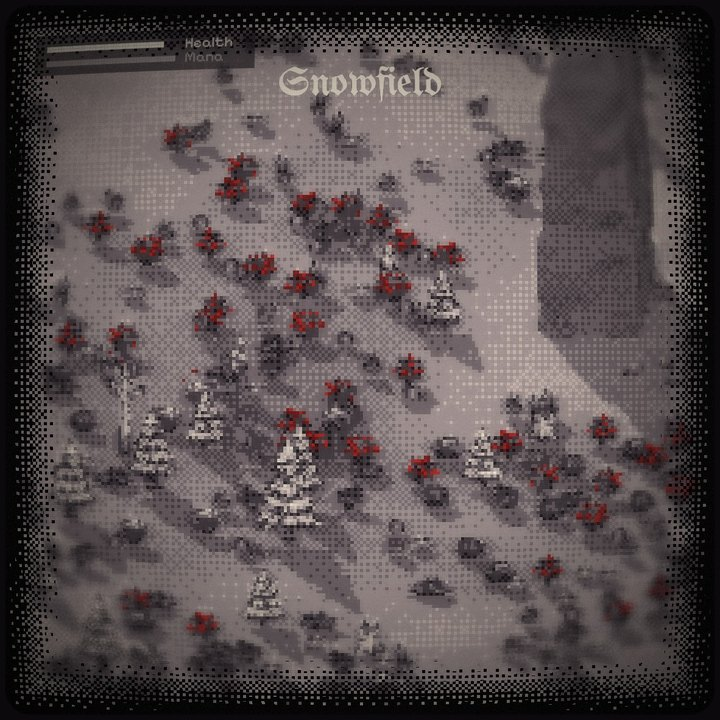 |
| **Into the abyss.** A ledge path down the wall of the abyss, and wild dogs. | **Snowfield.** The abyss opens onto a field of snow and wild roses. |
| 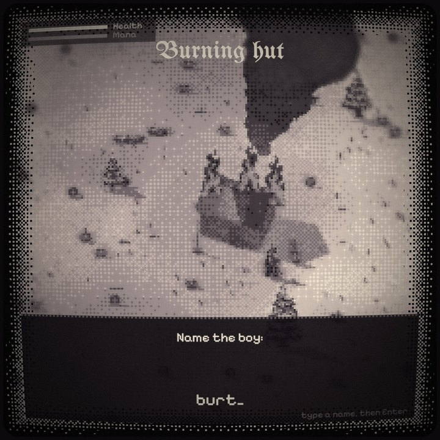 | 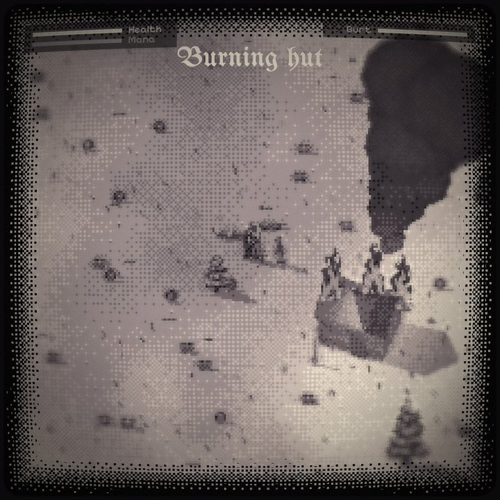 |
| **Burning hut.** A boy by a burning house. You name him and he follows you. | **The burial.** He leads you to his family. You bury them and say a prayer. |
| 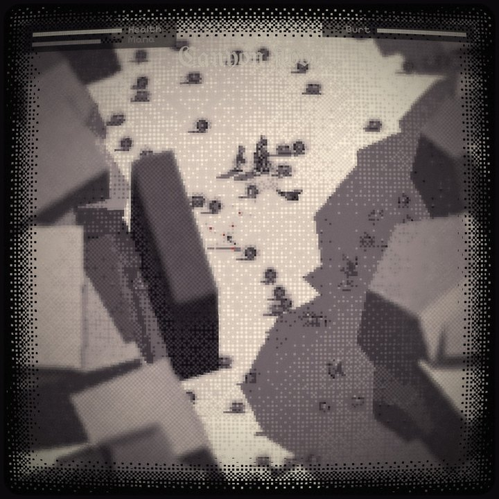 | 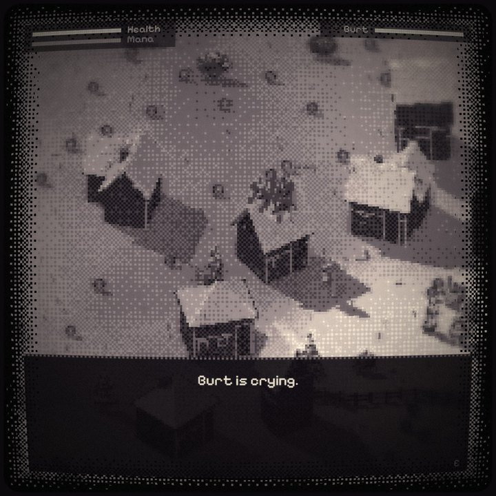 |
| **Canyon floor.** Ravens fly too high for a sword, so you use fire. | **Timber village.** Houses burn. Burn too many and the boy sits down and cries. |
| 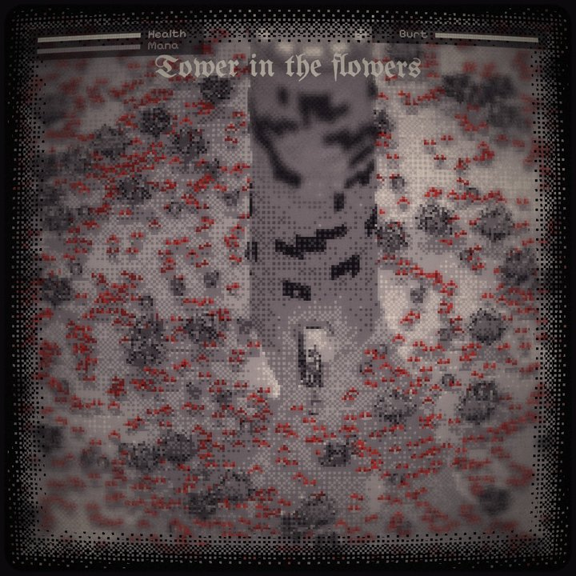 | 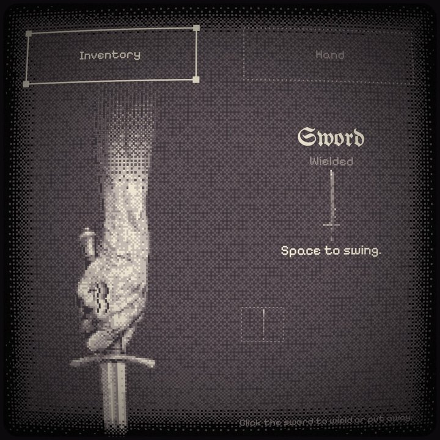 |
| **Tower in the flowers.** The end of the road. | **Inventory.** The hand hangs empty, or holds the sword when it is wielded. |
| 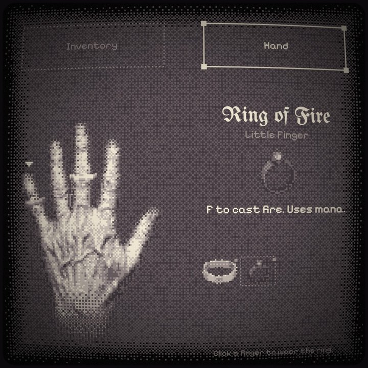 | |
| **Hand.** Any ring on any finger, in any order. | |

## What's in it

- **Rendering.** three.js at a native 240 × 240, then two post passes:
  - An ordered-dither pass onto a six-level palette, with red kept only for roses, blood and burning.
  - A CRT pass: barrel distortion, bloom, vignette, grain, and an edge that dissolves into the black in dither.
- **Sprites that belong to the world.**
  - Pixel sprites stand upright and take their depth from where they touch the ground, so anything in front of a base is in front of all of it.
  - They cast shadows through invisible casters that share their ground line.
  - Vegetation is cut into two-pixel strips that shiver by whole pixels when something walks through.
- **Height blur.** Things standing high, such as rock tops and clifftop buildings, go soft, as do the screen's edges.
- **Reflections.** In the lake, everything above the water has an upside-down twin beneath a thin, dark surface.
- **Procedural 3D.** Standing stones, the tower with its opening door and light, cottages of six kinds, fences, the courtyard and bridge, cliffs and spires.
- **Play.**
  - Sword and fire combat, galloping dogs and diving ravens.
  - A companion with his own health bar who fights beside you, leads you and reacts to what you do.
  - Rings you can wear on any finger.
  - Trees and houses you can burn.

## How it was made

The game, its engine, its asset pipeline and the promotional videos were written by **Claude Opus 5.5** in Claude Code, one request at a time.

The source art (characters, animals, vegetation, props, hands, rings and the sword) was generated with Gemini image models. It was then processed by the scripts in `tools/`, which do four things:

- sample each image's own pixel grid;
- pool it down to the game's scale (the knight is 17 px ≈ 1.8 m);
- lock it to the palette;
- pose walk cycles.

## Reference

The art direction and several scene compositions reference the Steam game **[O EMPIRE! WARD OFF THY ROT](https://store.steampowered.com/app/4331110/O_EMPIRE_WARD_OFF_THY_ROT/)**: its dithered CRT look, its monochrome palette with red as the only colour, and the scenes it shows. Mirror Ward is an independent homage. No screenshots, art or code from that game are included in this repository.

## Repository layout

| Path | Contents |
| --- | --- |
| `index.html` | The whole game, including the processed sprite sheets as embedded data |
| `worker.js`, `wrangler.jsonc`, `package.json` | The Cloudflare Worker that serves the game |
| `video-maker.html`, `Make Video.command` | The video maker: edit text and clips, render, download |
| `studio.js` | In-browser tool that renders the vertical promo videos (WebCodecs H.264 + AAC, muxed with `mp4-muxer`) |
| `prototypes/` | Earlier experiments: the first rose field and tower, the sprite-shadow sandbox, and the first scene replicas |
| `tools/` | Python asset pipeline, plus a small Swift frame grabber for checking rendered videos |
| `sprites/raw*` | The generated source images |
| `sprites/out4` | Previews of processed sheets, also used by `studio.js` |
| `docs/screenshots` | The screenshots above |
| `docs/playtest` | Captures from automated playthroughs, also used by `studio.js` |

## Making videos

Double-click `Make Video.command`. It opens the video maker in Chrome:

1. Edit the top text, the clips (scene and seconds), the punchline and the music.
2. Press **Render** and leave the tab in front for about a minute.
3. Press **Download MP4**.

The video maker saves your last settings, and **Reset to default** brings back the original meme.

## Deploy

The live site is a Cloudflare Worker, `mirror-ward`, on the route `mpts.ie/games/mirrorward*`. `worker.js` strips the `/games/mirrorward` prefix and serves `index.html` from the Worker's static assets. `wrangler.jsonc` holds the configuration.

```bash
npm install
npx wrangler login
npm run deploy
```

`npm run deploy` copies `index.html` into `dist/`, which is the only folder uploaded, then runs `wrangler deploy`.

mpts.ie itself is [BannerAndLogo](https://github.com/nassir90/BannerAndLogo) on `mpts.ie/*`; this route is more specific, so it wins. Mirror Ward is listed on the games index, [mpts.ie/games](https://mpts.ie/games/), and has a stack of clips on the home page (BannerAndLogo's `site/games/index.html` and `site/index.html`), so a changed route needs updating there too.

## Regenerating assets

The tools need Python 3 with Pillow and NumPy. The generation scripts call Gemini on Vertex AI. They take your Google Cloud project from the environment and read the API key from a file you pass in:

```bash
export GCP_PROJECT=your-project-id
python3 tools/gen4.py path/to/api.key sprites/raw4
```

The processing scripts (`process*.py`, `rescale.py`, `assets4.py`, `hands.py`, `gallop.py`, `kidsit.py`, `rings.py`) read and rewrite the `const GEN`, `const GEN2` and `const RINGS` data lines in `index.html`. Each takes the repository root as its first argument.
